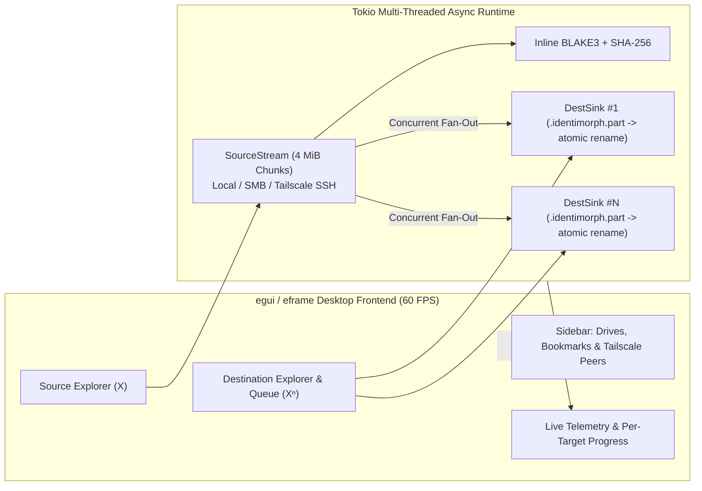

# IdentiMorph

> **$\mathrm{id}_X : X \to X$** (and universal diagonal fan-out **$\Delta_n : X \to X^n$**) — A lightweight Rust + `egui` + `tokio` file and AI-model transporter across local drives, SMB/UNC network shares, and Tailscale SSH hosts.

**IdentiMorph** makes moving massive multi-gigabyte model weights (`.safetensors` directories, `.gguf` + `mmproj` pairs, checkpoints) or any general files/folders across drives and machines effortless: browse your computer, NAS, or Tailnet in an explorer-style split view, point at one or multiple destinations (creating new folders inline if needed), and execute a verified, resumable async transfer.

---

## Key Features

- **Unified Dual-Pane Explorer (`egui` / `eframe`):**
  - Browse **Local Drives** (`C:\`, `D:\`, `/`, `~`), **SMB / UNC Shares** (`\\ZIMABOARD2\Ark\Models`), and **Remote SSH / Tailscale SSH Endpoints** (`ssh://root@zimaboard2/DATA/Ark/Models` or `user@host:/path`) side by side.
  - Create new folders inline (`+ New Folder`) on local, SMB, or remote SSH targets before or during target selection.
  - Native OS folder dialog fallback (`📂 OS...` via `rfd`) and persistent **Pinned Bookmarks** (`★ Pin`).
- **Live Tailscale Tailnet Discovery:**
  - Automatically queries `tailscale status --json` on launch to list every peer on your Tailnet (MagicDNS hostname, `100.x.y.z` WireGuard IP, online state, OS, and Tailscale SSH capability).
  - One-click **`SSH→Src`**, **`SSH→Dst`**, **`SMB→Src`**, and **`SMB→Dst`** buttons jump either explorer straight onto any Tailnet node.
  - Uses system OpenSSH (`BatchMode=yes`, `Compression=no`) so keyless **Tailscale SSH**, `ssh-agent`, and `~/.ssh/config` work out of the box with zero key-import friction.
- **Tokio Single-Read, Multi-Destination Fan-Out ($\Delta_n : X \to X^n$):**
  - Queue **1 or $N$ destinations** (even mixing local NVMe drives, LAN SMB shares, and remote Tailscale SSH servers in a single job).
  - Reads each **4 MiB** aligned chunk from the source **once** and fans it out concurrently to all destinations (`try_join_all`).
- **Crash-Safe Staging & Byte-Exact Resume:**
  - Writes in-flight data to `<filename>.identimorph.part` and atomically promotes to `<filename>` only upon full completion—preventing broken partial `.safetensors` or `.gguf` shards from masquerading as valid weights.
  - Resumes interrupted `.identimorph.part` files from the exact byte offset (`SeekFrom::Start` locally/SMB, `tail -c +N` + `cat >>` over SSH) without re-sending already transferred gigabytes.
- **Cryptographic Identity Verification ($\mathrm{id}(x) \stackrel{?}{=} x$):**
  - Computes inline **BLAKE3** (and **SHA-256** when POSIX SSH endpoints are involved) during the source read pass—zero double-reading of the source—and verifies every destination file after promotion.
- **AI Model Hygiene (While Working on Any File or Folder):**
  - Automatically skips `.cache/`, `*.incomplete`, `*.lock`, and `*.identimorph.part` artifacts when copying directories (toggleable in the header).
  - Detects companion multimodal projectors (`mmproj*.gguf`) in the same folder when selecting a `.gguf` model and offers a one-click **`+ Include mmproj`** action.

---

## Architecture



---

## Building & Running

Requires Rust `1.85+` (Edition 2024):

```bash
cargo run --release
```

### Running Tests & Lints

```bash
cargo fmt --check
cargo clippy --all-targets -- -D warnings
cargo test
```

---

## Path Formats Supported in Address Bars

| Transport | Example Syntax |
| :--- | :--- |
| **Local Windows / Unix** | `D:\Models\gguf` or `/mnt/nvme/models` |
| **Windows SMB / UNC (LAN or Tailnet)** | `\\ZIMABOARD2\Ark\Models\safetensors` or `\\100.88.12.34\Ark\Models` |
| **Tailscale SSH / OpenSSH URI** | `ssh://root@zimaboard2/DATA/Ark/Models` |
| **SCP Shorthand** | `root@zimaboard2:/DATA/Ark/Models` |

---

## License

Licensed under either of:

- Apache License, Version 2.0 ([LICENSE-APACHE](LICENSE-APACHE))
- MIT License ([LICENSE-MIT](LICENSE-MIT))

at your option.

